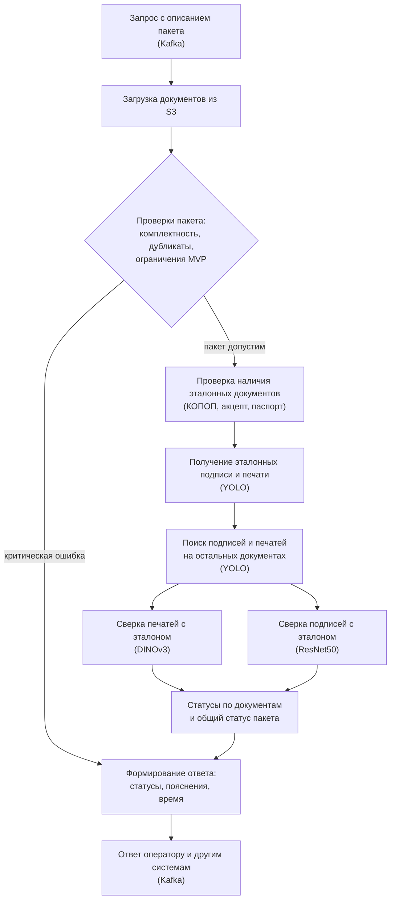
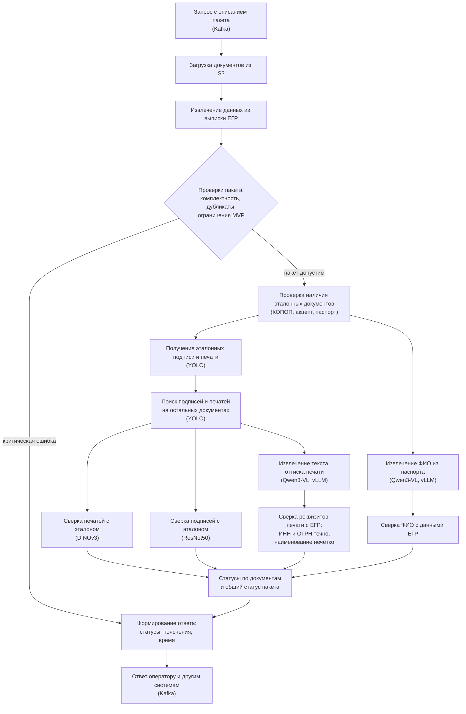

# Дизайн ML системы — Система автоматической проверки документов

## 1. Цели и предпосылки

### 1.1. Зачем идём в разработку продукта?

**Бизнес-цель.** Автоматизировать проверку подлинности печатей и подписей в пакетах банковских документов (досье) при онбординге клиентов (юридических лиц и индивидуальных предпринимателей), ускорить этот процесс и снизить нагрузку на операторов банка.

**Текущий процесс.** Модельный сервис будет частью автоматизированной системы внутреннего и внешнего документооборота банка. Сейчас от клиентов поступает большое количество пакетов документов, которые проверяются вручную. Оператор, ориентируясь на правила и требования к документам, проверяет пакет: наличие обязательных документов, отсутствие дубликатов, наличие эталонных документов для подписей и печатей (например, паспорт для подписи или КОПОП (карточка ОПОП) для подписи и печати). Затем он поочерёдно открывает каждый документ и проверяет, что подпись и (при наличии) печать совпадают с эталонными. Также оператор сверяет ФИО из паспорта с ФИО из выписки из ЕГРЮЛ/ЕГРИП (далее ЕГР), а ИНН, ОГРН и наименование организации на оттиске печати (если печать есть) с данными выписки ЕГР. По итогам проверки оператор проставляет пакету соответствующий статус.

**Проблемы текущего процесса.** Проверка выполняется вручную, не автоматизирована и неудобна для оператора, поскольку нужно открывать и сопоставлять каждый документ. При большом потоке пакетов это требует значительных трудозатрат. По примерной оценке, один пакет (4–8 документов) проверяется в среднем не более 5–6 минут.

**Почему станет лучше от использования ML.**

- Часть проверок (комплектность пакета, отсутствие дубликатов, соответствие ограничениям MVP) будет выполняться автоматически по правилам.
- Основные проверки напрямую решаются методами компьютерного зрения: обнаружение и сравнение подписей и печатей с эталоном, распознавание текста печати и ФИО.
- Автоматизация ускорит проверку и снизит нагрузку на операторов.
- Заказчик допускает возможность ошибок моделей, но требует, чтобы проверки, признанные пройденными, были действительно верными. Поэтому пакеты, прошедшие автоматическую проверку, не будут требовать ручной проверки, а непрошедшие будут передаваться оператору.

**Что считаем успехом итерации с точки зрения бизнеса.** Итерация будет считаться успешной, если выполнены бизнес-критерии и технические критерии, приведённые ниже.

*Бизнес-критерии:*

| Метрика | Что показывает | Целевое значение | Как измеряется |
|---|---|---|---|
| Доля досье, подтверждённых автоматически | Охват автоматизации: какая часть пакетов проходит все проверки без участия оператора | Не фиксируется, максимизируется при соблюдении лимита по FAR | Статистика работы сервиса |
| Экономия трудозатрат операторов | Сколько рабочего времени операторов освобождается | Расчётная величина | Число пакетов × доля автоматически подтверждённых × время ручной проверки одного пакета |

*Технические критерии:*

| Метрика | Что показывает | Целевое значение | Как измеряется |
|---|---|---|---|
| Доля ложных принятий (FAR) | Доля неверных случаев (например, подписей разных людей), ошибочно признанных пройденными | Не более 5–10% (по итогам обсуждения с заказчиком) | Контрольные пакеты документов с заранее известной разметкой |
| Время обработки пакета | Скорость работы сервиса | Не более 2 минут на пакет | Время обработки будет фиксироваться сервисом в ответе |

### 1.2. Бизнес-требования и ограничения

**Бизнес-требования.** Детальные требования зафиксированы в ТЗ, согласованном с заказчиком: в нём описаны ограничения модельного сервиса, формат входа с описанием каждого поля, формат выхода, ошибки и исключения, приведены примеры. Кратко, сервис должен принимать пакет документов клиента и выполнять следующие проверки:

1. **Комплектность пакета.** Сервис должен проверять наличие в пакете обязательных документов (КОПОП, паспорт, опросный лист, выписка ЕГР и другие в соответствии с ТЗ).
2. **Отсутствие дубликатов.** Сервис должен выявлять дубликаты документов в пакете. Обнаруженные дубликаты должны фиксироваться как предупреждение, остальные проверки при этом должны выполняться.
3. **Ограничения MVP.** Сервис должен проверять соответствие пакета ограничениям MVP: клиент является юридическим лицом или ИП; в пакете не более одного документа, удостоверяющего личность; при наличии заявления на открытие счёта в пакете есть КОПОП и (или) акцепт. При нарушении сервис должен вернуть критическую ошибку и не выполнять остальные проверки.
4. **Определение эталонов.** Сервис должен определять эталоны подписи и печати: эталоном подписи и печати служит КОПОП, эталоном печати может служить акцепт к КОПОП, при отсутствии КОПОП эталоном подписи служит паспорт. Если эталон не найден, сервис должен вернуть статус «нет эталона для сверки».
5. **Проверка подписей.** Сервис должен находить подпись на каждом проверяемом документе, оценивать её сходство с эталоном (числовая оценка по шкале 0–100) и по этой оценке определять, соответствует ли подпись эталону. Если подпись на проверяемом документе не найдена, сервис должен вернуть статус «не найдена подпись/печать документа».
6. **Проверка печатей.** Сервис должен находить печать на каждом проверяемом документе, оценивать визуальное сходство оттиска с эталоном (числовая оценка по шкале 0–100) и по этой оценке определять, соответствует ли печать эталону. Если печать на проверяемом документе не найдена, сервис должен вернуть аналогичный статус.
7. **Сверка реквизитов печати с ЕГР.** Сервис должен сверять текст оттиска печати (ИНН, ОГРН, наименование) с данными выписки ЕГР.
8. **Сверка ФИО.** Сервис должен сверять ФИО из паспорта и КОПОП с данными выписки ЕГР (фамилия, имя, отчество).
9. **Статусы и формирование ответа.** Сервис должен проставлять статус по каждой проверке (комплектность, дубликаты, ограничения MVP, сверка ФИО, сверка ИНН/ОГРН/наименования). Для проверок подписей и печатей статус должен проставляться отдельно по каждому проверяемому документу пакета. Кроме того, сервис должен формировать общий статус пакета (ok — всё в порядке, partial — есть предупреждения, error — критическая ошибка), общий статус по подписям и печатям (минимальный из статусов отдельных проверок), пояснения к статусам и время обработки. Перечень значений статусов и формат ответа зафиксированы в ТЗ, поскольку ответ будут использовать не только операторы, но и другие системы.

**Бизнес-ограничения.**

- Сервис должен работать в закрытом контуре банка. Документы содержат персональные данные (например, паспорта), поэтому должны использоваться только локальные модели, внешние API применяться не должны.
- Объём памяти GPU не должен превышать 20 ГБ.
- Время обработки одного пакета не должно превышать 2 минут.
- Сервис должен поддерживать только юридические лица и ИП.
- Сервис должен поддерживать следующие типы документов: карточка ОПОП (КОПОП), акцепт оферты, паспорт (документ, удостоверяющий личность), заявление на КБО, заявление на открытие счёта, договор банковского счёта, опросный лист, выписка из ЕГРЮЛ/ЕГРИП.
- Форматы входа и выхода должны соответствовать ТЗ.

**Что ожидается от итерации.** Выполнение критериев успеха, приведённых в разделе 1.1, а также согласование с заказчиком изменений ТЗ по итогам тестирования на тестовом контуре.

**Бизнес-процесс пилота.** Внедрение сервиса планируется поэтапно:

1. **Тестовый контур.** Заказчик будет вручную тестировать кейсы, задавать вопросы по ним и собирать проблемные кейсы и моменты для обсуждения и изменений.
2. **Промышленный контур в демо-режиме.** Объём документов и проверок будет больше, статистика будет собираться под постоянным наблюдением. Оператор будет сам отправлять запрос и проверять ответ сервиса.
3. **Постепенный переход к полноценному использованию на промышленном контуре.** Пакеты, по которым все проверки пройдены, не будут требовать ручной проверки. Пакеты с любым несоответствием или ошибкой будут передаваться оператору на ручную перепроверку.

**Предполагаемый сценарий использования сервиса.**

1. Запрос с описанием пакета (названия и типы документов, идентификаторы типов и документов, ссылки на документы в S3, идентификаторы клиента и досье) поступает в сервис через Kafka.
2. Сервис скачивает документы из S3.
3. Проверяются требования к самому пакету (комплектность, дубликаты, ограничения MVP).
4. Извлекаются эталоны, после чего выполняются проверки подписей и печатей, а также сверка данных с ЕГР.
5. Сервис формирует ответ в формате ТЗ и отправляет его через Kafka.
6. Ответ получает оператор и (или) другая система.

**Что считаем успешным пилотом и пути развития.** Пилот (демо-режим на промышленном контуре) будет считаться успешным, если на собранной статистике будут выполняться критерии успеха из раздела 1.1: доля ложных принятий не более 5–10% и время обработки пакета не более 2 минут. Путь развития: переход от демо-режима к полноценному использованию на промышленном контуре, при котором результат «все проверки пройдены» будет приниматься без ручной проверки.

### 1.3. Что входит в скоуп проекта/итерации, что не входит

**На закрытие каких бизнес-требований подписываемся в итерации.** В итерации планируется закрыть требования к пакету документов и проверку подписей и печатей:

- проверка комплектности пакета (требование 1);
- проверка отсутствия дубликатов (требование 2);
- проверка ограничений MVP (требование 3);
- определение эталонов подписи и печати (требование 4);
- проверка подписей, включая поиск подписи на документе (требование 5);
- проверка печатей (визуальное сходство), включая поиск печати на документе (требование 6);
- статусы и формирование ответа в части проверок, входящих в итерацию (требование 9).

**Что не будет закрыто.** Следующие требования планируется закрыть в последующих итерациях:

- сверка реквизитов печати с ЕГР (требование 7);
- сверка ФИО (требование 8);
- статусы и формирование ответа в части этих проверок (требование 9).

**Качество кода и воспроизводимость.** Весь функционал, реализованный в итерации, должен быть покрыт тестами. Конфигурация сервиса задаётся переменными окружения. Предусматриваются режим штатной работы (Kafka) и режим отладки (локальная обработка директории с досье). Модели выбираются автоматически в порядке приоритета: ONNX с квантованием, ONNX, PyTorch.

**Технический долг.** В рамках итерации не планируется настройка CI-процесса (автоматический запуск проверок при изменениях в репозитории).

### 1.4. Предпосылки решения

Решение опирается на следующие предпосылки.

1. **Единица обработки и гранулярность результата.** Сервис обрабатывает один пакет документов (досье) клиента за запрос. Результат формируется по каждой проверке, по каждому проверяемому документу и по пакету в целом. Обоснование: при ручной проверке оператор поочерёдно проверяет каждый документ пакета и по итогам проставляет статус пакету.
2. **Источники данных.** Для проверки используются только документы пакета, переданные в запросе: проверяемые банковские формы и эталонные документы (КОПОП, акцепт к КОПОП, паспорт, выписка ЕГР). Внешние источники данных не используются. Обоснование: в банке действует устоявшийся процесс документооборота, основанный на внутренних правилах и юридических требованиях, и сервис автоматизирует его, опираясь на те же документы, что и оператор. Дополнительно это согласуется с работой в закрытом контуре и с наличием персональных данных в документах.
3. **Подлинность как соответствие эталону.** Подлинность подписи и печати определяется как соответствие эталону из пакета, а не как абсолютная оценка подлинности. Обоснование: оператор сопоставляет подпись и печать на проверяемом документе с эталонными (КОПОП, паспорт).
4. **Тип клиента.** Тип клиента определяется по выписке ЕГР из пакета, поддерживаются только юридические лица и ИП. Обоснование: ограничения MVP, зафиксированные в ТЗ.
5. **Приоритет точности положительных вердиктов.** Ошибочное «ок» для бизнеса дороже ошибочного отказа: отказ приводит только к ручной перепроверке, а ошибочное «ок» пропускает неверный документ. Поэтому качество оценивается в первую очередь по доле ложных принятий (FAR), которая не должна превышать 5–10%.
6. **Данные для обучения и оценки качества.** Для обучения используется общая выгрузка данных из системы документооборота банка: порядка 500–1000 единиц на модель. Для модели поиска подписей и печатей единицей служит страница документа (изображение в формате JPG), для моделей оценки сходства подписи и печати (отдельно). В ходе итерации заказчик по мере тестирования будет предоставлять дополнительные данные: порядка 30–50 пакетов документов за итерацию. Качество будет оцениваться на контрольных пакетах, разметку которых (совпадают ли подписи и печати) заранее выполняют люди. Обоснование: размеченных данных ограниченное количество, поэтому используются и накопленная выгрузка, и данные, которые поступают в ходе тестирования с заказчиком.
7. **Формат входных документов.** Документы поступают в формате PDF.

## 2. Методология

### 2.1. Постановка задачи

С технической точки зрения система представляет собой комбинацию правил и ML-компонентов для верификации подписей и печатей в пакете документов. В части требований, входящих в итерацию, планируется решить следующие подзадачи:

| Подзадача | Тип задачи | Вход | Выход | Требования (раздел 1.2) |
|---|---|---|---|---|
| Проверка требований к пакету | Правила (без ML) | Список документов пакета, данные выписки ЕГР (тип клиента) | Статусы комплектности, дубликатов и ограничений MVP | 1, 2, 3 |
| Поиск подписей и печатей (в том числе эталонных) | Детекция объектов на изображении | Изображение страницы документа (PDF преобразуется в изображения) | Рамки подписей и печатей на странице | 4, 5, 6 |
| Оценка сходства с эталоном и решение о соответствии | Верификация «тот же / не тот же» методами метрического обучения (сравнение пары); решение о соответствии принимается по оценке сходства | Подпись (печать) на проверяемом документе и эталонная | Оценка сходства по шкале 0–100 и статус соответствия эталону | 5, 6 |
| Формирование статусов и ответа | Правила (без ML) | Результаты подзадач | Статусы по проверкам, документам и пакету, ответ | 9 |

Заказчику важна не только итоговая метка соответствия, но и сама оценка сходства: для подписей одного человека оценка должна быть выше, чем для подписей разных людей, а для разных людей достаточно низкой.

Из-за приоритета заказчика (ошибочное «ок» дороже ошибочного отказа) решающее правило будет подбираться так, чтобы доля ложных принятий (FAR) не превышала 5–10%. Случаи, не прошедшие проверку, передаются оператору на ручную проверку.

### 2.2. Блок-схема решения

Решение планируется как последовательность шагов: сначала проверяются требования к пакету, затем определяются эталоны, после чего подписи и печати проверяются параллельно. Ниже приведены схема итерации (MVP) и схема целевого решения (production), в которую добавлены проверки, не входящие в итерацию.

#### Блок-схема итерации (MVP)

В схеме итерации нет сверки реквизитов печати с ЕГР и сверки ФИО, так как эти проверки не входят в итерацию (раздел 1.3).

#### Блок-схема целевого решения (production)

В целевое решение добавляются сверка реквизитов печати с ЕГР и сверка ФИО. Они выполняются параллельно со сверкой подписей и печатей.

Выписка ЕГР поступает в формате PDF, поэтому данные из неё планируется извлекать из текстового слоя PDF-файла без распознавания изображения.

#### Описание шагов

| Шаг | Вход | Выход | Метод |
|---|---|---|---|
| Проверки пакета | Описание пакета, документы, данные выписки ЕГР (тип клиента) | Статусы комплектности, дубликатов и ограничений MVP; при критической ошибке дальнейшие проверки не выполняются | Правила |
| Проверка наличия эталонных документов | Документы пакета | Эталонные документы (КОПОП, акцепт, паспорт) или статус «нет эталона для сверки» | Правила |
| Получение эталонных подписи и печати | Изображения страниц эталонных документов | Эталонные подпись и печать | Детекция (YOLO) |
| Поиск подписей и печатей на остальных документах | Изображения страниц проверяемых документов | Рамки подписей и печатей; если не найдены, статус «не найдена подпись/печать документа» | Детекция (YOLO) |
| Сверка печатей с эталоном | Печать на проверяемом документе и эталонная печать | Оценка сходства 0–100 и соответствие эталону | Метрическое обучение (DINOv3) |
| Сверка подписей с эталоном | Подпись на проверяемом документе и эталонная подпись | Оценка сходства 0–100 и соответствие эталону | Метрическое обучение (ResNet50) |
| Формирование ответа | Результаты всех проверок | Статусы по проверкам, документам и пакету, пояснения, время обработки; ответ в формате ТЗ | Правила |

Шаги целевого решения, которых нет в итерации:

| Шаг | Вход | Выход | Метод |
|---|---|---|---|
| Извлечение данных из выписки ЕГР | Выписка ЕГР | Данные организации (ИНН, ОГРН, наименование, ФИО) | Извлечение текста из PDF (текстовый слой) |
| Извлечение текста оттиска печати | Найденная печать | Текст оттиска | Qwen3-VL (vLLM) |
| Сверка реквизитов печати с ЕГР | Текст оттиска печати, данные ЕГР | Статус сверки: ИНН и ОГРН сравниваются точно, наименование нечётко | Правила |
| Извлечение ФИО из паспорта | Изображение паспорта | ФИО | Qwen3-VL (vLLM) |
| Сверка ФИО с данными ЕГР | ФИО, данные ЕГР | Статус сверки ФИО | Правила |

#### Бейзлайн

Бейзлайном считается текущий ручной процесс: оператор последовательно проверяет документы пакета и проставляет статус, на что, по примерной оценке, уходит в среднем не более 5–6 минут на пакет. Решение сравнивается с ним по критериям успеха из раздела 1.1: доля ложных принятий не более 5–10% и время обработки пакета не более 2 минут.
