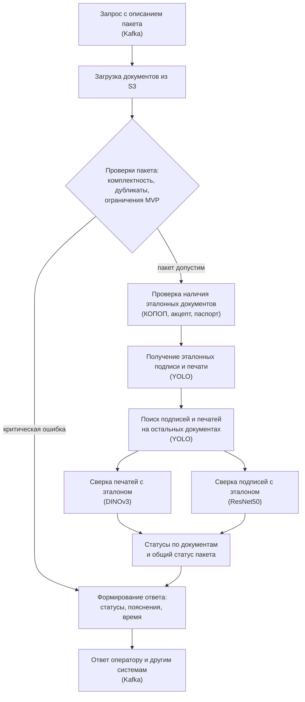
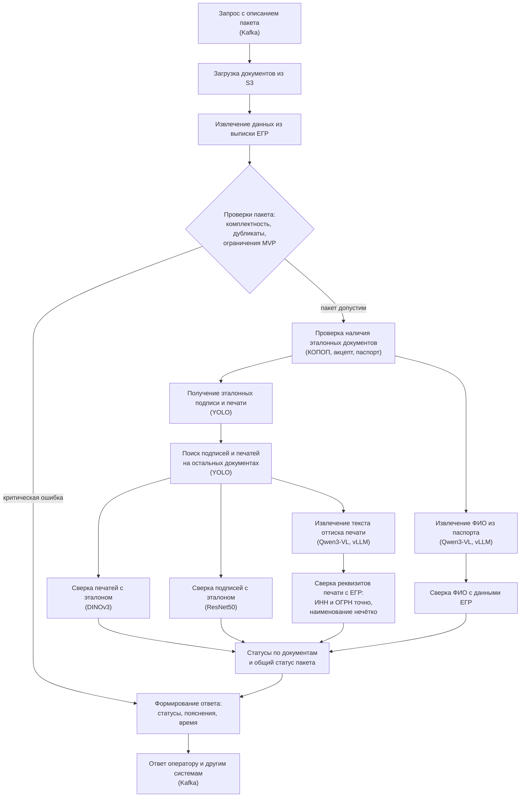

# Дизайн ML системы — Система автоматической проверки документов

## Содержание

- [1. Цели и предпосылки](#1-цели-и-предпосылки)
  - [1.1. Зачем идём в разработку продукта?](#11-зачем-идём-в-разработку-продукта)
  - [1.2. Бизнес-требования и ограничения](#12-бизнес-требования-и-ограничения)
  - [1.3. Что входит в скоуп проекта/итерации, что не входит](#13-что-входит-в-скоуп-проектаитерации-что-не-входит)
  - [1.4. Предпосылки решения](#14-предпосылки-решения)
- [2. Методология](#2-методология)
  - [2.1. Постановка задачи](#21-постановка-задачи)
  - [2.2. Блок-схема решения](#22-блок-схема-решения)
    - [Блок-схема итерации (MVP)](#блок-схема-итерации-mvp)
    - [Блок-схема целевого решения (production)](#блок-схема-целевого-решения-production)
    - [Описание шагов](#описание-шагов)
    - [Бейзлайн](#бейзлайн)

## 1. Цели и предпосылки

### 1.1. Зачем идём в разработку продукта?

**Бизнес-цель.** Автоматизировать проверку подлинности печатей и подписей в пакетах банковских документов (досье) при онбординге клиентов (юридических лиц и индивидуальных предпринимателей), ускорить этот процесс и снизить нагрузку на операторов банка.

**Текущий процесс.** Модельный сервис будет частью автоматизированной системы внутреннего и внешнего документооборота банка. Сейчас от клиентов поступает большое количество пакетов документов, которые проверяются вручную. Оператор, ориентируясь на правила и требования к документам, проверяет пакет: наличие обязательных документов, отсутствие дубликатов, наличие эталонных документов для подписей и печатей (например, паспорт для подписи или КОПОП (карточка ОПОП) для подписи и печати). Затем он поочерёдно открывает каждый документ и проверяет, что подпись и (при наличии) печать совпадают с эталонными. Также оператор сверяет ФИО из паспорта с ФИО из выписки из ЕГРЮЛ/ЕГРИП (далее ЕГР), а ИНН, ОГРН и наименование организации на оттиске печати (если печать есть) с данными выписки ЕГР. По итогам проверки оператор проставляет пакету соответствующий статус.

**Проблемы текущего процесса.** Проверка выполняется вручную, не автоматизирована и неудобна для оператора, поскольку нужно открывать и сопоставлять каждый документ. При большом потоке пакетов это требует значительных трудозатрат. По примерной оценке, один пакет (4–8 документов) проверяется в среднем не более 5–6 минут.

**Почему станет лучше от использования ML.**

- Часть проверок (комплектность пакета, отсутствие дубликатов, соответствие ограничениям MVP) будет выполняться автоматически по правилам.
- Основные проверки напрямую решаются методами компьютерного зрения: обнаружение и сравнение подписей и печатей с эталоном, распознавание текста печати и ФИО.
- Автоматизация ускорит проверку и снизит нагрузку на операторов.
- Заказчик допускает возможность ошибок моделей, но требует, чтобы проверки, признанные пройденными, были действительно верными. Поэтому пакеты, прошедшие автоматическую проверку, не будут требовать ручной проверки, а непрошедшие будут передаваться оператору.

**Что считаем успехом итерации с точки зрения бизнеса.** Итерация будет считаться успешной, если выполнены бизнес-критерии и технические критерии, приведённые ниже.

*Бизнес-критерии:*

| Метрика | Что показывает | Целевое значение | Как измеряется |
|---|---|---|---|
| Доля досье, подтверждённых автоматически | Охват автоматизации: какая часть пакетов проходит все проверки без участия оператора | Не фиксируется, максимизируется при соблюдении лимита по FAR | Статистика работы сервиса |
| Экономия трудозатрат операторов | Сколько рабочего времени операторов освобождается | Расчётная величина | Число пакетов × доля автоматически подтверждённых × время ручной проверки одного пакета |

*Технические критерии:*

| Метрика | Что показывает | Целевое значение | Как измеряется |
|---|---|---|---|
| Доля ложных принятий (FAR) | Доля неверных случаев (например, подписей разных людей), ошибочно признанных пройденными | Не более 5–10% (по итогам обсуждения с заказчиком) | Контрольные пакеты документов с заранее известной разметкой |
| Время обработки пакета | Скорость работы сервиса | Не более 2 минут на пакет | Время обработки будет фиксироваться сервисом в ответе |

### 1.2. Бизнес-требования и ограничения

**Бизнес-требования.** Детальные требования зафиксированы в ТЗ, согласованном с заказчиком: в нём описаны ограничения модельного сервиса, формат входа с описанием каждого поля, формат выхода, ошибки и исключения, приведены примеры. Кратко, сервис должен принимать пакет документов клиента и выполнять следующие проверки:

1. **Комплектность пакета.** Сервис должен проверять наличие в пакете обязательных документов (КОПОП, паспорт, опросный лист, выписка ЕГР и другие в соответствии с ТЗ).
2. **Отсутствие дубликатов.** Сервис должен выявлять дубликаты документов в пакете. Обнаруженные дубликаты должны фиксироваться как предупреждение, остальные проверки при этом должны выполняться.
3. **Ограничения MVP.** Сервис должен проверять соответствие пакета ограничениям MVP: клиент является юридическим лицом или ИП; в пакете не более одного документа, удостоверяющего личность; при наличии заявления на открытие счёта в пакете есть КОПОП и (или) акцепт. При нарушении сервис должен вернуть критическую ошибку и не выполнять остальные проверки.
4. **Определение эталонов.** Сервис должен определять эталоны подписи и печати: эталоном подписи и печати служит КОПОП, эталоном печати может служить акцепт к КОПОП, при отсутствии КОПОП эталоном подписи служит паспорт. Если эталон не найден, сервис должен вернуть статус «нет эталона для сверки».
5. **Проверка подписей.** Сервис должен находить подпись на каждом проверяемом документе, оценивать её сходство с эталоном (числовая оценка по шкале 0–100) и по этой оценке определять, соответствует ли подпись эталону. Если подпись на проверяемом документе не найдена, сервис должен вернуть статус «не найдена подпись/печать документа».
6. **Проверка печатей.** Сервис должен находить печать на каждом проверяемом документе, оценивать визуальное сходство оттиска с эталоном (числовая оценка по шкале 0–100) и по этой оценке определять, соответствует ли печать эталону. Если печать на проверяемом документе не найдена, сервис должен вернуть аналогичный статус.
7. **Сверка реквизитов печати с ЕГР.** Сервис должен сверять текст оттиска печати (ИНН, ОГРН, наименование) с данными выписки ЕГР.
8. **Сверка ФИО.** Сервис должен сверять ФИО из паспорта и КОПОП с данными выписки ЕГР (фамилия, имя, отчество).
9. **Статусы и формирование ответа.** Сервис должен проставлять статус по каждой проверке (комплектность, дубликаты, ограничения MVP, сверка ФИО, сверка ИНН/ОГРН/наименования). Для проверок подписей и печатей статус должен проставляться отдельно по каждому проверяемому документу пакета. Кроме того, сервис должен формировать общий статус пакета (ok — всё в порядке, partial — есть предупреждения, error — критическая ошибка), общий статус по подписям и печатям (минимальный из статусов отдельных проверок), пояснения к статусам и время обработки. Перечень значений статусов и формат ответа зафиксированы в ТЗ, поскольку ответ будут использовать не только операторы, но и другие системы.

**Бизнес-ограничения.**

- Сервис должен работать в закрытом контуре банка. Документы содержат персональные данные (например, паспорта), поэтому должны использоваться только локальные модели, внешние API применяться не должны.
- Объём памяти GPU не должен превышать 20 ГБ.
- Время обработки одного пакета не должно превышать 2 минут.
- Сервис должен поддерживать только юридические лица и ИП.
- Сервис должен поддерживать следующие типы документов: карточка ОПОП (КОПОП), акцепт оферты, паспорт (документ, удостоверяющий личность), заявление на КБО, заявление на открытие счёта, договор банковского счёта, опросный лист, выписка из ЕГРЮЛ/ЕГРИП.
- Форматы входа и выхода должны соответствовать ТЗ.

**Что ожидается от итерации.** Выполнение критериев успеха, приведённых в разделе 1.1, а также согласование с заказчиком изменений ТЗ по итогам тестирования на тестовом контуре.

**Бизнес-процесс пилота.** Внедрение сервиса планируется поэтапно:

1. **Тестовый контур.** Заказчик будет вручную тестировать кейсы, задавать вопросы по ним и собирать проблемные кейсы и моменты для обсуждения и изменений.
2. **Промышленный контур в демо-режиме.** Объём документов и проверок будет больше, статистика будет собираться под постоянным наблюдением. Оператор будет сам отправлять запрос и проверять ответ сервиса.
3. **Постепенный переход к полноценному использованию на промышленном контуре.** Пакеты, по которым все проверки пройдены, не будут требовать ручной проверки. Пакеты с любым несоответствием или ошибкой будут передаваться оператору на ручную перепроверку.

**Предполагаемый сценарий использования сервиса.**

1. Запрос с описанием пакета (названия и типы документов, идентификаторы типов и документов, ссылки на документы в S3, идентификаторы клиента и досье) поступает в сервис через Kafka.
2. Сервис скачивает документы из S3.
3. Проверяются требования к самому пакету (комплектность, дубликаты, ограничения MVP).
4. Извлекаются эталоны, после чего выполняются проверки подписей и печатей, а также сверка данных с ЕГР.
5. Сервис формирует ответ в формате ТЗ и отправляет его через Kafka.
6. Ответ получает оператор и (или) другая система.

**Что считаем успешным пилотом и пути развития.** Пилот (демо-режим на промышленном контуре) будет считаться успешным, если на собранной статистике будут выполняться критерии успеха из раздела 1.1: доля ложных принятий не более 5–10% и время обработки пакета не более 2 минут. Путь развития: переход от демо-режима к полноценному использованию на промышленном контуре, при котором результат «все проверки пройдены» будет приниматься без ручной проверки.

### 1.3. Что входит в скоуп проекта/итерации, что не входит

**На закрытие каких бизнес-требований подписываемся в итерации.** В итерации планируется закрыть требования к пакету документов и проверку подписей и печатей:

- проверка комплектности пакета (требование 1);
- проверка отсутствия дубликатов (требование 2);
- проверка ограничений MVP (требование 3);
- определение эталонов подписи и печати (требование 4);
- проверка подписей, включая поиск подписи на документе (требование 5);
- проверка печатей (визуальное сходство), включая поиск печати на документе (требование 6);
- статусы и формирование ответа в части проверок, входящих в итерацию (требование 9).

**Что не будет закрыто.** Следующие требования планируется закрыть в последующих итерациях:

- сверка реквизитов печати с ЕГР (требование 7);
- сверка ФИО (требование 8);
- статусы и формирование ответа в части этих проверок (требование 9).

**Качество кода и воспроизводимость.** Весь функционал, реализованный в итерации, должен быть покрыт тестами. Конфигурация сервиса задаётся переменными окружения. Предусматриваются режим штатной работы (Kafka) и режим отладки (локальная обработка директории с досье). Модели выбираются автоматически в порядке приоритета: ONNX с квантованием, ONNX, PyTorch.

**Технический долг.** В рамках итерации не планируется настройка CI-процесса (автоматический запуск проверок при изменениях в репозитории).

### 1.4. Предпосылки решения

Решение опирается на следующие предпосылки.

1. **Единица обработки и гранулярность результата.** Сервис обрабатывает один пакет документов (досье) клиента за запрос. Результат формируется по каждой проверке, по каждому проверяемому документу и по пакету в целом. Обоснование: при ручной проверке оператор поочерёдно проверяет каждый документ пакета и по итогам проставляет статус пакету.
2. **Источники данных.** Для проверки используются только документы пакета, переданные в запросе: проверяемые банковские формы и эталонные документы (КОПОП, акцепт к КОПОП, паспорт, выписка ЕГР). Внешние источники данных не используются. Обоснование: в банке действует устоявшийся процесс документооборота, основанный на внутренних правилах и юридических требованиях, и сервис автоматизирует его, опираясь на те же документы, что и оператор. Дополнительно это согласуется с работой в закрытом контуре и с наличием персональных данных в документах.
3. **Подлинность как соответствие эталону.** Подлинность подписи и печати определяется как соответствие эталону из пакета, а не как абсолютная оценка подлинности. Обоснование: оператор сопоставляет подпись и печать на проверяемом документе с эталонными (КОПОП, паспорт).
4. **Тип клиента.** Тип клиента определяется по выписке ЕГР из пакета, поддерживаются только юридические лица и ИП. Обоснование: ограничения MVP, зафиксированные в ТЗ.
5. **Приоритет точности положительных вердиктов.** Ошибочное «ок» для бизнеса дороже ошибочного отказа: отказ приводит только к ручной перепроверке, а ошибочное «ок» пропускает неверный документ. Поэтому качество оценивается в первую очередь по доле ложных принятий (FAR), которая не должна превышать 5–10%.
6. **Данные для обучения и оценки качества.** Для обучения используется общая выгрузка данных из системы документооборота банка: порядка 500–1000 единиц на модель. Для модели поиска подписей и печатей единицей служит страница документа (изображение в формате JPG), для моделей оценки сходства подписи и печати (отдельно). В ходе итерации заказчик по мере тестирования будет предоставлять дополнительные данные: порядка 30–50 пакетов документов за итерацию. Качество будет оцениваться на контрольных пакетах, разметку которых (совпадают ли подписи и печати) заранее выполняют люди. Обоснование: размеченных данных ограниченное количество, поэтому используются и накопленная выгрузка, и данные, которые поступают в ходе тестирования с заказчиком.
7. **Формат входных документов.** Документы поступают в формате PDF.

## 2. Методология

### 2.1. Постановка задачи

С технической точки зрения система представляет собой комбинацию правил и ML-компонентов для верификации подписей и печатей в пакете документов. В части требований, входящих в итерацию, планируется решить следующие подзадачи:

| Подзадача | Тип задачи | Вход | Выход | Требования (раздел 1.2) |
|---|---|---|---|---|
| Проверка требований к пакету | Правила (без ML) | Список документов пакета, данные выписки ЕГР (тип клиента) | Статусы комплектности, дубликатов и ограничений MVP | 1, 2, 3 |
| Поиск подписей и печатей (в том числе эталонных) | Детекция объектов на изображении | Изображение страницы документа (PDF преобразуется в изображения) | Рамки подписей и печатей на странице | 4, 5, 6 |
| Оценка сходства с эталоном и решение о соответствии | Верификация «тот же / не тот же» методами метрического обучения (сравнение пары); решение о соответствии принимается по оценке сходства | Подпись (печать) на проверяемом документе и эталонная | Оценка сходства по шкале 0–100 и статус соответствия эталону | 5, 6 |
| Формирование статусов и ответа | Правила (без ML) | Результаты подзадач | Статусы по проверкам, документам и пакету, ответ | 9 |

Заказчику важна не только итоговая метка соответствия, но и сама оценка сходства: для подписей одного человека оценка должна быть выше, чем для подписей разных людей, а для разных людей достаточно низкой.

Из-за приоритета заказчика (ошибочное «ок» дороже ошибочного отказа) решающее правило будет подбираться так, чтобы доля ложных принятий (FAR) не превышала 5–10%. Случаи, не прошедшие проверку, передаются оператору на ручную проверку.

### 2.2. Блок-схема решения

Решение планируется как последовательность шагов: сначала проверяются требования к пакету, затем определяются эталоны, после чего подписи и печати проверяются параллельно. Ниже приведены схема итерации (MVP) и схема целевого решения (production), в которую добавлены проверки, не входящие в итерацию.

#### Блок-схема итерации (MVP)

В схеме итерации нет сверки реквизитов печати с ЕГР и сверки ФИО, так как эти проверки не входят в итерацию (раздел 1.3).

#### Блок-схема целевого решения (production)

В целевое решение добавляются сверка реквизитов печати с ЕГР и сверка ФИО. Они выполняются параллельно со сверкой подписей и печатей.

Выписка ЕГР поступает в формате PDF, поэтому данные из неё планируется извлекать из текстового слоя PDF-файла без распознавания изображения.

#### Описание шагов

| Шаг | Вход | Выход | Метод |
|---|---|---|---|
| Проверки пакета | Описание пакета, документы, данные выписки ЕГР (тип клиента) | Статусы комплектности, дубликатов и ограничений MVP; при критической ошибке дальнейшие проверки не выполняются | Правила |
| Проверка наличия эталонных документов | Документы пакета | Эталонные документы (КОПОП, акцепт, паспорт) или статус «нет эталона для сверки» | Правила |
| Получение эталонных подписи и печати | Изображения страниц эталонных документов | Эталонные подпись и печать | Детекция (YOLO) |
| Поиск подписей и печатей на остальных документах | Изображения страниц проверяемых документов | Рамки подписей и печатей; если не найдены, статус «не найдена подпись/печать документа» | Детекция (YOLO) |
| Сверка печатей с эталоном | Печать на проверяемом документе и эталонная печать | Оценка сходства 0–100 и соответствие эталону | Метрическое обучение (DINOv3) |
| Сверка подписей с эталоном | Подпись на проверяемом документе и эталонная подпись | Оценка сходства 0–100 и соответствие эталону | Метрическое обучение (ResNet50) |
| Формирование ответа | Результаты всех проверок | Статусы по проверкам, документам и пакету, пояснения, время обработки; ответ в формате ТЗ | Правила |

Шаги целевого решения, которых нет в итерации:

| Шаг | Вход | Выход | Метод |
|---|---|---|---|
| Извлечение данных из выписки ЕГР | Выписка ЕГР | Данные организации (ИНН, ОГРН, наименование, ФИО) | Извлечение текста из PDF (текстовый слой) |
| Извлечение текста оттиска печати | Найденная печать | Текст оттиска | Qwen3-VL (vLLM) |
| Сверка реквизитов печати с ЕГР | Текст оттиска печати, данные ЕГР | Статус сверки: ИНН и ОГРН сравниваются точно, наименование нечётко | Правила |
| Извлечение ФИО из паспорта | Изображение паспорта | ФИО | Qwen3-VL (vLLM) |
| Сверка ФИО с данными ЕГР | ФИО, данные ЕГР | Статус сверки ФИО | Правила |

#### Бейзлайн

Бейзлайном считается текущий ручной процесс: оператор последовательно проверяет документы пакета и проставляет статус, на что, по примерной оценке, уходит в среднем не более 5–6 минут на пакет. Решение сравнивается с ним по критериям успеха из раздела 1.1: доля ложных принятий не более 5–10% и время обработки пакета не более 2 минут.

### 2.3. Этапы решения задачи

**Этап 1. Подготовка данных**

**1. Описание данных и сущностей. Результаты EDA, проблемы, ограничения и риски**

Система должна обрабатывать пакеты банковских документов клиентов. Документы поступают в формате PDF; для поиска подписей и печатей страницы должны преобразовываться в изображения. Найденные подписи и оттиски должны сравниваться с эталонами из документов того же пакета.

Основные сущности:

- пакет документов клиента;
- документ и отдельная страница;
- подпись или оттиск печати;
- эталонный и проверяемый объект;
- идентификатор подписанта или рабочей группы печатей;
- разметка расположения объектов и их соответствия эталону.

**Банковские данные.** Первоначальный датасет был собран после крупной выгрузки из системы документооборота и содержит ориентировочно 1500 экземпляров.

Разметку выполняет отдельная команда разметчиков. Отдельные примеры также может размечать разработчик — data scientist. Правильность разметки проверяется визуально.

Для расширения данных во внутреннем контуре используются открытые источники, аугментации и синтетическая генерация. В рабочих заметках зафиксировано использование 61 шаблона печати. Для дальнейшего расширения разнообразия предусматривается ориентир 50–100 пригодных шаблонов. Разные изображения одной печати при этом не должны считаться разными независимыми печатями.

**Подготовленные данные.** Для воспроизводимых экспериментов подготовлены отдельные наборы на основе публичных источников и синтетики:

| Набор | Объём | Назначение |
|---|---:|---|
| Кропы подписей | 2383 изображения от 248 людей | Подготовка и проверка подхода к сравнению подписей |
| Кропы печатей | 2496 изображений | Подготовка и проверка подхода к сравнению оттисков |
| Полные страницы | 2493 страницы, 5366 объектов | Подготовка и проверка детекции подписей и печатей |

Для страниц сохранены рамки, типы объектов и принадлежность подписи или печати клиенту либо банку. Для вставок сохраняется связь с исходным изображением, подписантом или рабочей группой печатей.

**Что проверялось при EDA**

EDA выполнен отдельно для полных страниц и кропов, поскольку они используются разными моделями: страницы — для детекции объектов, кропы — для сравнения подписей и печатей с эталонами. Для детекции важны размеры и размещение объектов на странице, а для сравнения — сохранность рисунка, естественные различия исполнений и корректность принадлежности объектов одному подписанту или печати.

| Проверка и цель | Как проверялось | Что выяснилось |
|---|---|---|
| **Состав и баланс.** Определить фактическое наполнение наборов | Подсчёт страниц, объектов, подписантов, шаблонов, типов документов и объектов каждой роли | На страницах представлены пять семейств макетов. Есть 192 страницы без рукописных объектов. Частоты типов документов задаются генерацией |
| **Целостность разметки.** Исключить технически некорректные примеры | Сопоставление изображений, рамок, масок и метаданных; проверка координат, пустых масок и контрольных сумм | В активном наборе страниц не обнаружены пустые маски, ошибки геометрии рамок и выходы объектов за страницу |
| **Повторы и независимость.** Отличить число изображений от разнообразия источников | Поиск точных дублей по хешам, анализ повторного использования сканов и сходства страниц по pHash | Точных пиксельных дублей страниц нет, но макеты и исходники повторяются. |
| **Размеры и сохранность деталей.** Оценить последствия предобработки | Измерение размеров объектов и диагностическое уменьшение кропов и целых страниц; анализ штрихов и связности | При уменьшении до 640 px по длинной стороне страницы рост фрагментации наблюдается у 3,16% подписей. Более крупное изображение сохраняет детали лучше, но оптимальный вход модели ещё не выбран |
| **Качество чернил и отбор.** Найти потерю штрихов, фон и смещение выборки | Измерение контраста, толщины и связности; сравнение подготовленных слоёв с исходниками и вставками | Найден остаток фона в одном слое подписи, повторённом в двух вставках. Предварительная фильтрация также смещает состав в сторону более выраженных штрихов |
| **Наложения.** Оценить представленность сложных условий | По маскам измерялись пересечения чернил; отдельно анализировались линии и печатный фон | На полных страницах найдено 45 пересекающихся пар подпись–печать. Тяжёлые наложения представлены слабо; подписи не пересекают выделенные длинные линии бланков |
| **Эталоны и комплекты.** Проверить пригодность для сравнения | Проверка наличия эталонов, согласованности идентификаторов и различия естественных сканов | У доступных эталонных пар идентификаторы согласованы, сканы подписей различаются. Один частичный комплект не имеет активной страницы эталонов и пригоден только для детекции |

**Выявленные проблемы данных**

Проблемы — конкретные дефекты или недостатки организации данных, которые требуют исправления либо явного учёта.

Во внутреннем контуре ранее выявлялись:

- ошибки отнесения подписей клиента и сотрудника банка к классам;
- недостатки группировки подписей по подписантам;
- различие между чистыми обучающими подписями и рабочими кропами с печатями, текстом и линиями;
- совпадение обучающей и валидационной выборок в одной из прежних версий датасета детектора.

В текущих данных выявлены остаток фона в двух вставках подписи и связь отдельных условий генерации с источником. Эти находки зафиксированы; их исправление не считается выполненным автоматически.

**Ограничения данных**

Ограничения определяют границы доступных данных:

- банковские документы нельзя выносить из закрытого контура;
- первоначальная выгрузка ограничена, а новые кейсы поступают небольшими партиями;
- синтетика повторно использует ограниченный набор подписантов, печатей и макетов;
- аугментации одного изображения не создают независимые естественные исполнения или реальные оттиски.

**Риски при использовании данных**

Риски — возможные последствия перечисленных проблем и ограничений:

- завышение качества при попадании связанных исходников в обучение и проверку;
- запоминание макетов, размеров, цвета или условий генерации вместо устойчивых признаков объекта;
- ухудшение качества на новых формах документов и сложных наложениях;
- обучение на ошибочной разметке;
- ошибочное принятие несоответствующей подписи или печати из-за недостаточно представительной контрольной выборки.

**2. Процесс получения, разметки, аугментации и генерации данных**

**Получение и пополнение банковских данных**

Первичная выборка формируется крупной выгрузкой из системы документооборота банка. Затем данные дополняются кейсами, которые тестировщики и заказчик обнаруживают во время тестирования модели.

Пополнение происходит по мере проведения тестирования — ориентировочно раз в квартал. Очередная партия может содержать 20–60 пакетов, примерно по 4–5 документов в каждом. Это ориентир процесса, а не фиксированная автоматическая периодичность выгрузки или переобучения.

Новые кейсы должны проходить проверку состава, разметку и визуальный контроль. Необходимо сохранять их происхождение и принадлежность исходному пакету, чтобы учитывать связанные документы при последующем разделении выборок.

**Разметка**

Для детекции необходимы рамки подписей и печатей и их классы. Для сравнения необходима информация о принадлежности подписей одному подписанту и оттисков одной печати, а также связь проверяемого объекта с эталоном.

Основную разметку выполняет команда разметчиков; разработчик может размечать отдельные примеры и уточнять обнаруженные ошибки. Контроль проводится визуально. Выявленные расхождения должны исправляться до использования соответствующей версии разметки в эксперименте.

**Аугментации и синтетика**

Для увеличения разнообразия данных внутри контура применяются аугментации существующих изображений и генерация синтетических примеров с использованием открытых источников.

При подготовке синтетики:

1. Проверяются исходные изображения, повторы и принадлежность подписей или печатей рабочим группам.
2. Выделяются слои чернил, пригодные для размещения на другом фоне.
3. Подписи и печати размещаются на нейтральных бланках либо в кропах с печатными элементами.
4. Варьируются масштаб, поворот отдельных объектов, цвет, плотность чернил и качество изображения.
5. Добавляются пересечения с печатями, текстом и линиями, характерные для проверяемых документов.
6. После преобразований рассчитывается разметка и сохраняются метаданные источников и параметров генерации.
7. Результат проходит техническую и выборочную визуальную проверку.

Преобразования должны сохранять принадлежность объекта исходному подписанту или печати. Недостающие штрихи не должны дорисовываться произвольно. Размер оттиска подбирается с учётом исходной детализации; небольшой размер не является основанием исключать шаблон из пула.

В текущей реализации изображения сохраняются в PNG, рамки — в формате YOLO, метаданные — в JSON/JSONL. Для воспроизводимости сохраняются параметры генерации, версии исходников и случайное зерно.

**3. Действия при недостатке данных**

Предусматриваются следующие действия:

- **Недостаточно новых подписантов или печатей:** искать дополнительные открытые источники и получать новые разрешённые примеры внутри контура.
- **Недостаточно вариативности одного объекта:** использовать разные естественные исполнения, реальные оттиски и контролируемые аугментации.
- **Недостаточно сложных условий:** генерировать дополнительные наложения и вариации качества, ориентируясь на кейсы заказчика.
- **Недостаточно типов документов:** расширять набор макетов и контрольных примеров.
- **Недостаточно независимых данных для оценки:** формировать отдельную контрольную выборку внутри банка; увеличение синтетики не заменяет такую проверку.

Для расширения пула печатей устанавливается ориентир 50–100 пригодных шаблонов. Их пригодность и рабочие группы должны проверяться отдельно: количество файлов не равно количеству разных печатей.

**4. Конфиденциальная информация и её обработка**

Банковские документы содержат персональные и конфиденциальные сведения. Исходные документы, подписи, печати и внутренние идентификаторы не должны выноситься из контура банка. Обработка банковских данных должна выполняться внутри этого контура.

Использование открытых датасетов внутри банка для обучения моделей разрешено. Такие данные могут дополнять внутреннюю выборку и использоваться для генерации синтетики.

Для материалов вне контура используются публичные источники и нейтральные бланки с реквизитами.

**5. Необходимый результат этапа**

Результатом этапа должны стать подготовленные и версионированные данные, на которых можно воспроизводимо разрабатывать и оценивать ML-компоненты системы.

Должны быть получены:

1. **Наборы по модельным задачам.** Страницы с разметкой для детекции и отдельные изображения подписей и печатей с идентификаторами, необходимыми для сравнения с эталоном.
2. **Проверенная разметка.** Рамки, классы и связи объектов должны соответствовать изображениям. Обнаруженные ошибки должны быть исправлены либо примеры должны быть явно исключены из соответствующего использования.
3. **Метаданные происхождения.** Для каждого примера должны быть известны источник, исходное изображение, принадлежность пакету и рабочей группе, а для синтетики — применённые преобразования. Производные одного источника должны оставаться прослеживаемыми.
4. **Основа для независимого разделения.** Должны быть подготовлены групповые идентификаторы и результаты проверки пересечений. Окончательное разделение должно соответствовать схеме валидации, согласуемой на этапе подготовки моделей.
5. **Отчёт о качестве и покрытии.** Необходимо зафиксировать объём, разнообразие, качество, ошибки разметки, представленные условия и известные пробелы. Ограничения набора должны сопровождать результаты экспериментов.
6. **Воспроизводимая генерация.** Должны сохраняться конфигурации, версии исходников, параметры аугментаций и метаданные, позволяющие повторить подготовку набора.
7. **Порядок дальнейшего пополнения.** Новые кейсы должны проходить тот же цикл проверки, разметки и контроля, а изменения состава — фиксироваться в новой версии данных.
8. **Соблюдение границ доступа.** Банковские данные остаются в контуре.

Критерии готовности этапа: техническая корректность данных, прослеживаемая разметка, воспроизводимость подготовки и возможность провести оценку с явно обозначенными условиями независимости и покрытия.

**6. Дополнительные материалы**

Результаты EDA сохранены в едином ноутбуке с выполненными ячейками, визуализациями и выводами. Отдельно сохранены измерения, сведения о происхождении данных и перечень проблем для последующей обработки.

Выводы EDA должны использоваться при выборе предобработки, схемы валидации и состава дальнейших экспериментов. Найденные ограничения не считаются устранёнными только потому, что подготовка набора технически воспроизводима.

**Этап 2. Подготовка прогнозных моделей**

**1. ML-метрики и функции потерь**

Решение должно включать детектор подписей и печатей, модель сравнения подписей и модель сравнения печатей. Детектор должен различать четыре класса: подпись клиента, печать клиента, подпись банка и печать банка.

В текущей итерации основной акцент должен быть сделан на сравнении подписей. Проверка печатей сохраняется в составе решения, однако имеет второстепенный приоритет из-за ограниченного количества и разнообразия доступных открытых данных.

Качество детекции должно оцениваться по mAP@0.5:0.95, mAP@0.5, Precision и Recall отдельно для каждого класса. Дополнительно должны анализироваться матрица ошибок классов и ложные обнаружения на страницах без подписей и печатей. Precision и Recall должны рассчитываться при зафиксированном пороге уверенности, с однозначным сопоставлением предсказаний и разметки по классу и IoU. Для оценки при IoU 0.5 одному объекту разметки должно соответствовать не более одного предсказания.

Для сравнения подписей и печатей основной ограничивающей метрикой должна быть доля ложных принятий — FAR: число отрицательных пар, ошибочно признанных совпавшими, делённое на число всех отрицательных пар. FAR должна рассчитываться отдельно для подписей и печатей и не превышать 10%. Это ограничение относится к сравнению объектов, а не к итоговому решению по досье.

При соблюдении ограничения FAR необходимо максимизировать TAR — долю правильно принятых положительных пар. Дополнительно должна рассчитываться FRR — доля положительных пар, ошибочно признанных несовпавшими. Для анализа должны использоваться ROC-кривые и распределения сходства положительных и отрицательных пар.

Пороги для подписей и печатей должны подбираться независимо на валидационной выборке в процессе обучения и экспериментов. Их численные значения заранее не устанавливаются. На итоговой тестовой выборке должны применяться уже выбранные пороги. Если тестовая FAR превышает 10%, ограничение не выполнено; подстраивать порог по итоговому тесту нельзя.

В отчёте должны указываться числа положительных и отрицательных пар, независимых людей и групп печатей, а также неопределённость оценки. Аугментации одного источника не должны учитываться как независимые наблюдения при оценке неопределённости.

Для детектора предлагается использовать стандартную функцию потерь выбранной YOLO: BCE для классификации, CIoU для локализации и DFL для уточнения границ. Соотношение компонентов должно задаваться конфигурацией обучения.

Для моделей сравнения предлагается CosineEmbeddingLoss: для положительных пар она увеличивает косинусное сходство, для отрицательных — снижает его до заданного margin. Margin является гиперпараметром обучения и не совпадает с порогом принятия решения. Его значение должно подбираться на валидационной выборке.

**2. Схема ML-валидации**

Разделение данных должно выполняться по исходным сущностям до формирования пар и генерации производных сцен. Все естественные образцы подписи одного человека должны попадать в одну часть выборки. Аналогичное правило должно применяться к группам печатей, включая вероятные варианты одного источника. Документы одного досье должны оставаться вместе. При разделении необходимо учитывать также источники подписей и печатей, используемые как помехи.

В качестве стартовой схемы предлагается разбиение train/validation/test в пропорции 70/15/15 по группам. Фактическое количество объектов и групп в каждой части должно фиксироваться в manifest. Это предложение протокола, а не описание уже выполненного разделения.

EDA показал, что текущие синтетические комплекты связаны общими людьми и печатями. Поэтому случайное разделение готовых страниц не обеспечит независимую проверку. Для получения независимых частей необходимо сначала разделить исходные пулы и затем сформировать производные сцены с соблюдением этого разделения. При небольшом числе групп печатей можно дополнительно использовать групповую кросс-валидацию внутри обучающей и валидационной частей; итоговый тест должен оставаться отдельным.

Положительные пары подписей должны по возможности состоять из разных естественных образцов одного человека, отрицательные — из образцов разных людей. Для печатей положительные пары должны относиться к одной рабочей группе, отрицательные — к разным группам. Варианты одного исходного изображения необходимо отличать от независимых оттисков.

Обучающая выборка должна пополняться после полноценной выгрузки документов и их разметки. Небольшие партии новых кейсов могут включаться в последующие версии тестовой выборки после проверки разметки, повторов и пересечения источников. Кейсы, использованные для настройки моделей, предобработки или порогов, должны рассматриваться как материал для отладки и регрессионных проверок, а не как нетронутый итоговый тест. Сравнение вариантов моделей должно выполняться на одной зафиксированной версии оценочной выборки.

Модели сравнения необходимо оценивать отдельно на кропах по разметке и на кропах, полученных детектором. Пропуски детектора должны отражаться в сквозной оценке и не исключаться из неё незаметно.

**3. Структура ML-бейзлайна, предобработка и моделирование**

Ручная проверка оператором является бизнес-бейзлайном. Для воспроизводимого сравнения модельных подходов предлагается следующий ML-бейзлайн:

| Компонент | Предлагаемый подход |
|---|---|
| Детекция | YOLO11s с предобученными на COCO весами и дообучением на четырёх классах |
| Сравнение подписей | ResNet50 с предобученными ImageNet-весами; замороженный энкодер и обучаемая проекционная голова |
| Сравнение печатей | DINOv3 ViT-S/16 с предобученными весами; замороженный энкодер и обучаемая проекционная голова |

Доступность выбранных архитектур и весов описана в официальных источниках: [YOLO11](https://docs.ultralytics.com/models/yolo11/), [ResNet50](https://docs.pytorch.org/vision/stable/models/generated/torchvision.models.resnet50.html), [DINOv3](https://github.com/facebookresearch/dinov3).

Для детектора предлагается стартовое разрешение с длинной стороной страницы 1280 пикселей, сохранением пропорций и дополнением до требуемого размера. Выбор обусловлен обнаруженным при EDA ухудшением штрихов при уменьшении страницы до 640 пикселей. Возможность работы в пределах GPU 20 ГБ должна проверяться экспериментально, а не предполагаться заранее. Пороги уверенности детектора и NMS должны подбираться на валидационной выборке.

Кропы должны подготавливаться без обрезания штрихов и изменения пропорций, с дополнением белым фоном. Одинаковая предобработка должна применяться к эталонному и проверяемому объекту. В качестве начальных размеров предлагаются 128×256 пикселей RGB для подписей и 224×224 для печатей. Нормализация значений пикселей должна соответствовать используемым предобученным весам; сохранность деталей при выбранной геометрии необходимо проверить.

Для каждого вида объектов должна использоваться отдельная модель сравнения. Эталон и проверяемый объект должны обрабатываться энкодером с общими весами. Предлагается проекционная голова размерности 256 с L2-нормализацией эмбеддингов и косинусной мерой сходства.

На первом шаге предлагается заморозить энкодеры и обучать только проекционные головы. Дополнительно следует оценить более простой вариант: сравнение нормализованных признаков замороженного энкодера без обучаемой головы.

Процесс моделирования должен включать подготовку независимых выборок и пар, фиксацию конфигураций, обучение детектора и моделей сравнения, выбор гиперпараметров на валидации, подбор отдельных порогов, фиксацию выбранного варианта и итоговую оценку на тесте и в полном процессе обработки. Уверенность детектора и сходство пары являются разными величинами и должны иметь отдельные пороги.

**4. Стратегии дальнейшего развития решения**

Для детектора следует рассмотреть другие размеры модели, обогащение сложными наложениями, балансировку классов и изменение аугментаций. Если мелкие объекты плохо обнаруживаются при обработке полной страницы, можно проверить обработку фрагментов страницы.

Для моделей сравнения можно проверить постепенное размораживание последних блоков энкодера, RGB и оттенки серого, размеры входов, нормализацию масштаба объектов, другие функции метрического обучения и подбор сложных отрицательных пар только внутри обучающей выборки. Расширение данных должно увеличивать число независимых людей и групп печатей, а не только число аугментаций.

Оптимизация может включать learning rate, размер batch, margin, размерность эмбеддинга и параметры аугментаций. Новые варианты должны сравниваться с зафиксированным бейзлайном без повторной настройки на итоговом тесте.

**5. Анализ и интерпретация работы моделей**

Для детектора должны анализироваться пропуски, ложные обнаружения, ошибки класса, неточные границы и повторные обнаружения одного объекта. Для моделей сравнения — ложные принятия и отклонения, распределения сходства и случаи около порога.

Анализ должен выполняться в разрезах типов документов, ролей объектов, размеров, качества и наложений. При разборе ошибок необходимо сопоставлять изображение, разметку, предсказание и оценку сходства, а также разделять ошибки детектора и ошибки сравнения.

Следует проверять, не использует ли модель фон, линии бланка, цвет или другие особенности генерации вместо формы подписи и печати. Диагностические изменения фона, цвета и умеренные геометрические преобразования могут использоваться для анализа устойчивости, но не заменяют независимую оценку.

**6. Риски и способы их снижения**

| Риск | Способ снижения |
|---|---|
| Пересечение источников между частями выборки | Групповое разделение людей, печатей, досье и источников помех до генерации |
| Запоминание фона, цвета или масштаба | Разнообразие условий генерации и диагностические проверки зависимости от побочных признаков |
| Ошибки разметки и группировки | Визуальный контроль и фиксация версий разметки |
| Малое число независимых групп печатей | Расширение пула, групповая валидация и оценка неопределённости |
| Слишком простые положительные пары | Разные естественные подписи и независимые оттиски при наличии |
| Настройка по итоговому тесту | Разделение валидации и теста, фиксация порогов до тестовой оценки |
| Ошибки детекции ухудшают сравнение | Оценка на эталонных и предсказанных кропах, сквозной анализ пропусков |
| Вычислительная стоимость | Экспериментальная проверка потребления GPU и скорости выбранной конфигурации |

Одна точечная оценка FAR недостаточна для уверенного вывода о выполнении ограничения при малом числе независимых наблюдений. В этом случае необходимо явно указывать неопределённость и потребность в дополнительных независимых данных.

**7. Необходимый результат этапа**

На выходе должны быть получены веса и конфигурации выбранных моделей, зафиксированные выборки и пары, отчёт по четырём классам детектора и отдельные отчёты по сравнению подписей и печатей. Для моделей сравнения должны указываться FAR, TAR, FRR, выбранные пороги, объём независимых данных и неопределённость оценки.

Дополнительно должны быть подготовлены результаты сквозной оценки, сведения о вычислительных ресурсах и каталог характерных ошибок. На итоговом тесте FAR должна быть не более 10% при порогах, выбранных на валидационной выборке; иначе ограничение считается невыполненным. Требования обработки до двух минут на досье и GPU до 20 ГБ являются требованиями проекта, а не уже измеренными результатами.

**8. Дополнительная информация**

Для представления косинусного сходства по шкале 0–100 предлагается преобразование `score = 50 × (1 + cos(e_ref, e_doc))`. Эта величина не является вероятностью подлинности. Решение о соответствии должно приниматься по отдельному порогу для подписей и для печатей.

Версии данных, весов, конфигураций и порогов должны позволять различать результаты экспериментов. При сборке дизайн-документа прежние упоминания FAR «5–10%» необходимо согласовать с принятым ограничением 10% для сравнений подписей и печатей.

**Этап 3. Определение эталонов подписи и печати**

Для каждого пакета документов сервис должен определять одну эталонную подпись и одну эталонную печать клиента. Источники эталонов выбираются по приоритету документов, установленному в ТЗ: КОПОП, акцепт и паспорт в зависимости от вида эталона и наличия документов.

Эталонные подписи и печати должны выделяться той же моделью детекции, которая используется для остальных документов пакета. Для сравнения должны использоваться объекты клиента.

Если соответствующий эталон отсутствует, не найден моделью или непригоден для сравнения, сервис должен указать отсутствие эталона в выходном JSON и установить значение сходства `null`. Зависящая от этого эталона проверка не проводится. Проверки подписи и печати обрабатываются независимо.

Необходимый результат этапа — определённые эталоны для последующих сравнений либо статусы, объясняющие невозможность соответствующей проверки.

**Этап 4. Применение бизнес-правил и формирование ответа**

До выполнения модельных проверок сервис должен проверить комплектность пакета, отсутствие дубликатов и соблюдение ограничений MVP в соответствии с ТЗ. Дубликаты должны фиксироваться как предупреждение без остановки остальных проверок. Нарушения ограничений MVP должны приводить к критической ошибке и прекращению дальнейших проверок.

Для каждого проверяемого документа сервис должен находить подписи и печати клиента и сравнивать их с соответствующими эталонами пакета.

Единицей проверки является документ целиком. Все найденные подписи клиента должны сравниваться с эталонной подписью, а все найденные печати клиента — с эталонной печатью. Итоговой оценкой документа отдельно для подписей и печатей должна быть минимальная схожесть среди соответствующих сравнений, включая объекты на разных страницах.

Такое правило необходимо, поскольку документ с хотя бы одной подозрительной подписью или печатью нельзя признавать успешно прошедшим проверку. Например, при оценках сходства подписей 92, 87 и 61 в результат документа записывается 61 и статус, соответствующий этой оценке.

Пороги соответствия должны подбираться отдельно для подписей и печатей в процессе обучения моделей и экспериментов. Их численные значения заранее не задаются. В выходном JSON должны сохраняться как рассчитанное значение сходства, так и статус «совпал / не совпал», определённый по соответствующему порогу.

Если эталон отсутствует либо модель не обнаружила подпись или печать в проверяемом документе, сервис должен вернуть соответствующий статус и значение сходства `null`. Отсутствие объекта, отсутствие эталона и несовпадение должны различаться в ответе.

Выходной JSON должен содержать результаты по документам, статусы проверок пакета и общий статус в соответствии с ТЗ. Отдельные результаты по страницам, координаты объектов и изображения в ответ не включаются.

Необходимый результат этапа — JSON, соответствующий ТЗ и различающий успешные проверки, несовпадения, отсутствие необходимых объектов и ошибки обработки.

**Этап 5. Сборка процесса обработки досье и проверка результатов**

Сервис должен объединять получение документов, подготовку страниц, проверки пакета, определение эталонов, детекцию, сравнение и формирование ответа в единую последовательность обработки досье.

Должны предусматриваться два сценария работы:

- **Во внутреннем контуре при промышленной эксплуатации:** запрос поступает через Kafka, документы загружаются из S3, ответ в формате JSON возвращается через Kafka.
- **При локальной работе:** документы хранятся на диске, вместо ссылок на документы используются локальные пути. Результат обработки сохраняется в JSON-файл.

Правила проверки документов и формирования результатов должны быть одинаковыми для обоих сценариев.

Повреждение документа или страницы и невозможность их обработки должны фиксироваться в предусмотренных статусах выходного JSON. Невыполненная из-за ошибки проверка не должна обозначаться как успешно пройденная.

Проверка полного процесса должна выполняться на контрольных досье. Для каждого досье необходимо проверить корректность выбора эталонов, результаты сравнения подписей и печатей, выбор минимальной схожести в рамках документа и формирование статусов.

Если разметка доступна, результаты должны сопоставляться с ней. При отсутствии разметки проверка может проводиться вручную: разработчик или специалист, знакомый с правилами проверки документов, просматривает исходное досье и оценивает корректность результата в JSON.

Следует рассмотреть как успешно обрабатываемые досье, так и случаи несовпадения, отсутствия эталонов или объектов, нескольких подписей и печатей с разными оценками, дубликатов, нарушения ограничений MVP и повреждённых документов.

Необходимый результат этапа — единый процесс обработки досье в локальном и внутреннем сценариях, формирующий JSON по ТЗ, и выводы по проверке его работы на контрольных примерах.
